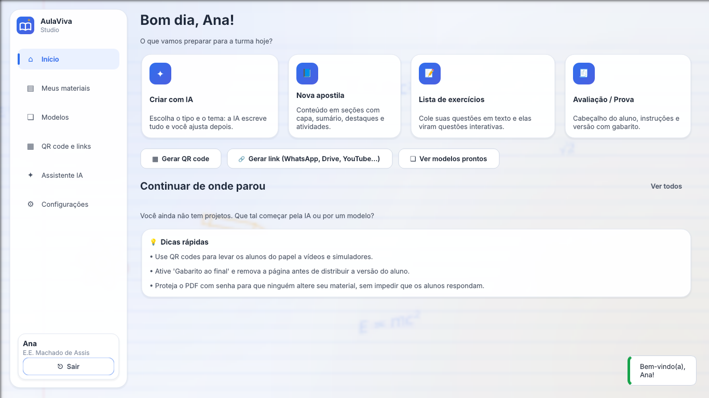
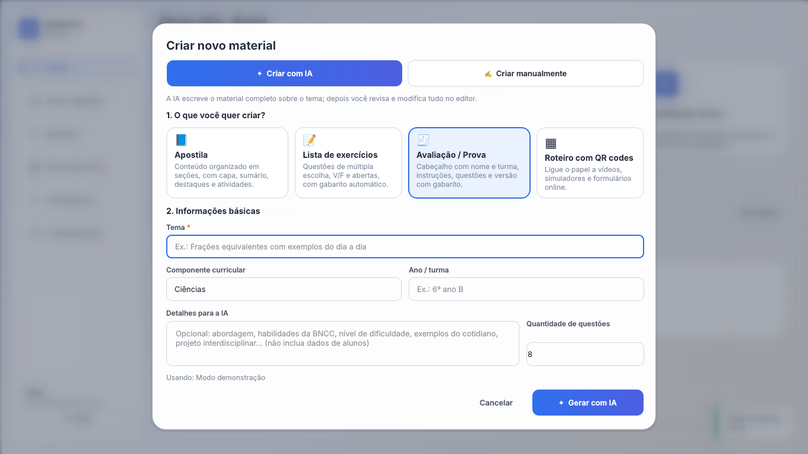
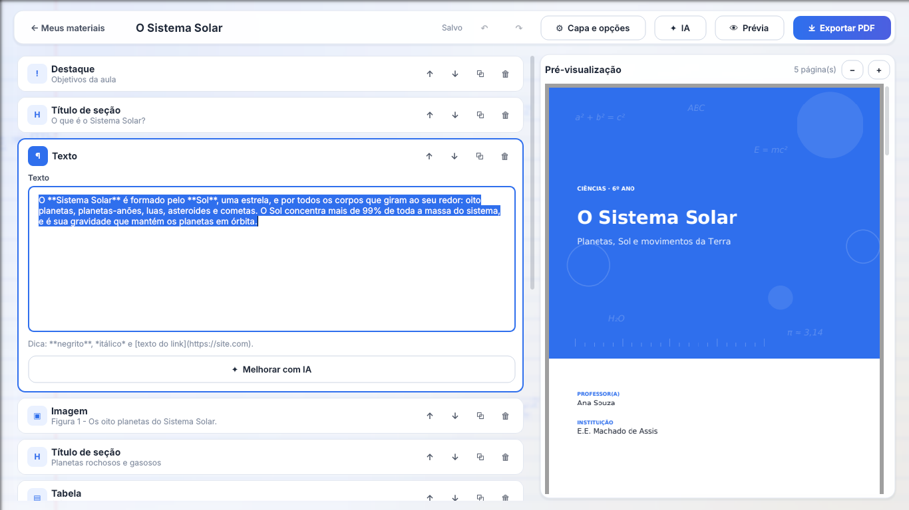
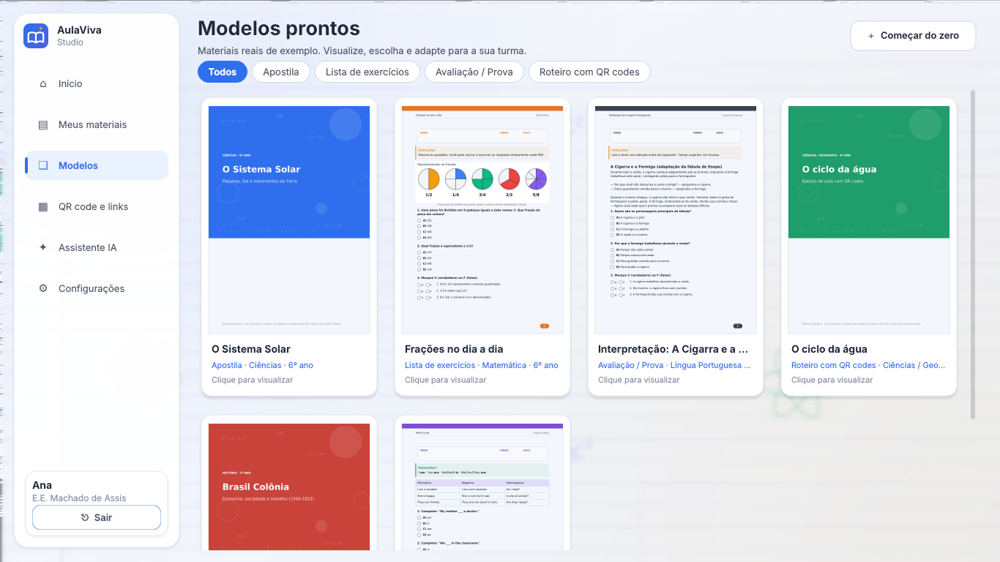
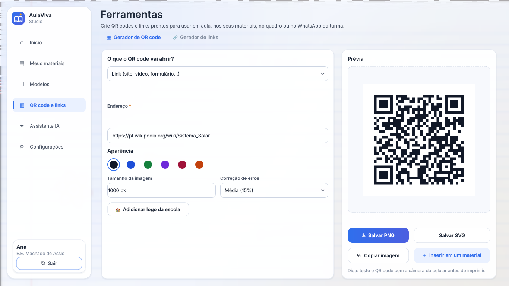

# AulaViva Studio

Aplicativo para **Windows e Linux** que ajuda professores a criar **apostilas, listas de exercícios, provas e
roteiros de aula em PDF interativo**, com QR codes, links, vídeos, documentos Word, exercícios respondíveis no
próprio PDF e um **assistente de IA** (com opções gratuitas).



## Principais recursos

| | |
|---|---|
| **Criar com IA** | Escolha o tipo (apostila, lista, prova ou roteiro), informe o tema e a turma: a IA escreve o material completo e você modifica o que quiser no editor. |
| **Criar manualmente** | Editor em cartões: cada bloco é editado direto no documento. Botão **＋ Adicionar** com todos os tipos de bloco explicados. |
| **Lista rápida** | Digite ou cole as questões em texto comum e elas viram questões interativas (múltipla escolha, V/F, abertas), com gabarito. |
| **Modelos prontos** | Materiais reais por disciplina (Ciências, Matemática, Português, História, Geografia, Inglês), com ilustrações e prévia da página. |
| **QR code e links** | Gerador de QR code (PNG/SVG, cores, logo da escola, Wi-Fi) e de links (WhatsApp, e-mail, YouTube no minuto certo, Drive, cópia do Google Docs, Maps, limpeza de rastreadores). |
| **PDF interativo** | Capa, sumário clicável, QR codes e botões clicáveis, campos de resposta, anexos Office, gabarito, proteção AES-256. Exporta as versões **aluno** e **professor** de uma vez. |
| **Segurança** | Argon2id, dados pessoais criptografados (AES-256-GCM), cofre do sistema para chaves, bloqueio por inatividade, LGPD (exportar/excluir dados). |

<table>
<tr><td></td><td></td></tr>
<tr><td></td><td></td></tr>
</table>

Mais telas em [`docs/screenshots`](docs/screenshots). Exemplos de PDFs gerados em [`docs/`](docs).

## Assistente de IA: use a sua preferida

| Opção | Custo | Onde obter a chave |
|---|---|---|
| Modo demonstração | grátis | já vem ativo (conteúdo de exemplo, não é IA real) |
| **Ollama** (IA local) | grátis, 100% privado | sem chave: instale em ollama.com e rode `ollama pull qwen2.5:7b` |
| **Google Gemini** | plano gratuito | aistudio.google.com |
| **Groq** | plano gratuito | console.groq.com |
| **OpenRouter** | modelos gratuitos e pagos | openrouter.ai |
| **Mistral** | plano gratuito experimental | console.mistral.ai |
| Claude (Anthropic) | pago | console.anthropic.com |
| ChatGPT (OpenAI) | pago | platform.openai.com |
| DeepSeek | pago (barato) | platform.deepseek.com |
| Outro compatível com OpenAI | variável | LM Studio, servidores próprios... |

Configure em *Configurações > Inteligência Artificial* e use **Testar conexão**. As chaves ficam no cofre do
sistema operacional. Nenhuma chave vem embutida no app (seria extraível do executável). Dados pessoais de
professores e alunos nunca são enviados à IA.

## Instalar e usar

### Windows: instalador pronto
Baixe o `AulaVivaStudio-Setup-x.y.z.exe` na página **Releases** deste repositório e instale. O instalador é
gerado automaticamente pelo GitHub Actions a cada nova versão (tag `v*`).

### Windows: a partir do código
1. Instale o [Python 3.12](https://www.python.org/downloads/) marcando **"Add python.exe to PATH"**.
2. Baixe o código (botão **Code > Download ZIP**) e extraia.
3. Dê dois cliques em **`ABRIR_AulaViva.bat`** (na primeira vez ele instala tudo sozinho).
4. Para gerar o seu próprio `.exe`/instalador: **`GERAR_EXE_Windows.bat`**.

### Linux
```bash
python3 -m venv .venv && .venv/bin/pip install -r requirements.txt
.venv/bin/python run.py
```
Pacote instalável: `bash packaging/build_linux.sh` gera `dist/AulaVivaStudio-linux-x86_64.tar.gz`; depois de
extrair, rode `./install_linux.sh`.

## Desenvolvimento

```bash
pip install -r requirements-dev.txt
QT_QPA_PLATFORM=offscreen python -m pytest -q      # testes (segurança, PDF, IA, ferramentas, interface)
python run.py                                       # abre o app
AulaVivaStudio.exe --selftest                       # verifica um executável gerado (código 0 = OK)
```

Branches: `main` (versões estáveis) e `develop` (desenvolvimento). Os testes rodam no GitHub Actions em Windows e
Linux a cada push; ao criar uma tag `vX.Y.Z`, o workflow `build` gera e publica os instaladores.

```
aulaviva/
  core/   security · database · auth · projects · pdf_builder · quicklist · ai · samples · qrtools · linktools · oauth
  ui/     theme · effects · widgets · onboarding · auth_views · dashboard · editor · quick_create
          templates_page · tools_page · main_window
  assets/ ícones, fontes livres (DejaVu) e ícones de interface
tests/    testes automatizados
packaging/ PyInstaller, Inno Setup, scripts de build, atalho Linux
docs/     SECURITY.md · OAUTH.md · capturas de tela · PDFs de exemplo
```

Segurança: [docs/SECURITY.md](docs/SECURITY.md) · Login com Google/Microsoft/gov.br: [docs/OAUTH.md](docs/OAUTH.md) ·
Histórico de versões: [CHANGELOG.md](CHANGELOG.md)
