<div align="center">

# AulaViva Studio

**Crie aulas, atividades, provas, projetos e vídeos animados em minutos, com IA.**
Para professores da educação básica, em português, inglês e espanhol.

[**Abrir o AulaViva Studio →**](https://matheus1906-hash.github.io/Aula-Viva-Studio/)

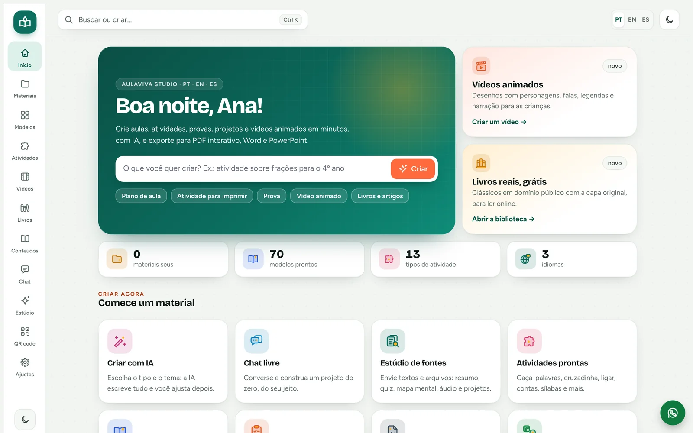

</div>

## Por que usar

- **Tudo em um lugar:** apostilas, listas de exercícios, provas, roteiros com QR code, planos de aula, projetos, atividades para imprimir e vídeos animados.
- **IA que trabalha para você:** descreva o tema e a turma; a IA escreve o material completo, alinhado à BNCC, e você ajusta no editor.
- **Pronto para a sala:** exporte em **PDF interativo** (o aluno responde no próprio arquivo), **Word**, **PowerPoint**, HTML, Markdown ou texto, nas versões do aluno e do professor.
- **Sem instalar nada:** funciona no navegador do computador e do celular. Os materiais ficam salvos no seu navegador.
- **Três idiomas:** interface e materiais em português, inglês ou espanhol.

## Recursos

### Editor em blocos com prévia ao vivo
Títulos, textos, destaques, imagens, QR codes, links, vídeos, múltipla escolha, verdadeiro ou falso, perguntas abertas, completar lacunas, ligar colunas, tabelas, caça-palavras e cruzadinhas. A prévia mostra a versão do aluno e a do professor, com gabarito.

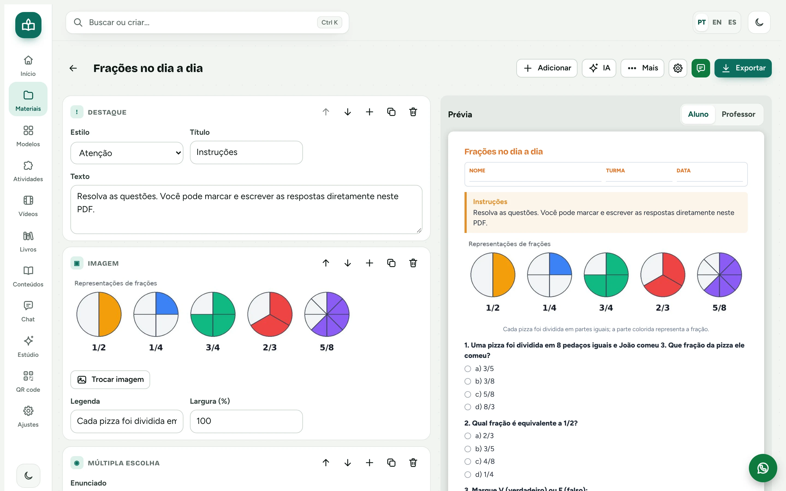

### Vídeos animados para crianças
Desenhos originais com personagens, cenários, balões de fala, legendas e narração em voz alta. Comece por um dos 12 modelos (ciclo da água, vogais, Sistema Solar, Cerrado…) ou peça para a IA escrever o roteiro. Edite cena por cena e baixe o vídeo em `.webm`.

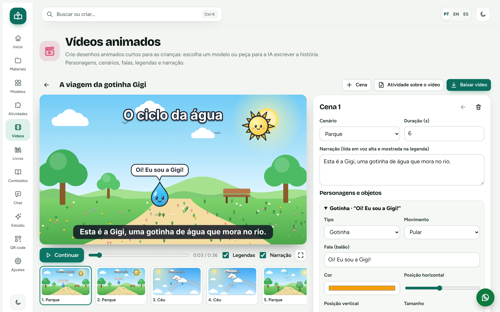

### Leitura na biblioteca
121 livros com texto hospedado na plataforma (Machado de Assis, Alencar, Eça, Lobato, Kipling, Stevenson, Austen, Twain, Galdós, Quiroga, Dewey, Montessori…) para ler diretamente na biblioteca, com referência ABNT e atividade de leitura gerada por IA. Inclui também um acervo comentado com 196 obras de educação, busca inteligente e atalhos para 20 bibliotecas digitais.

| Estante | Ficha do livro |
|---|---|
| 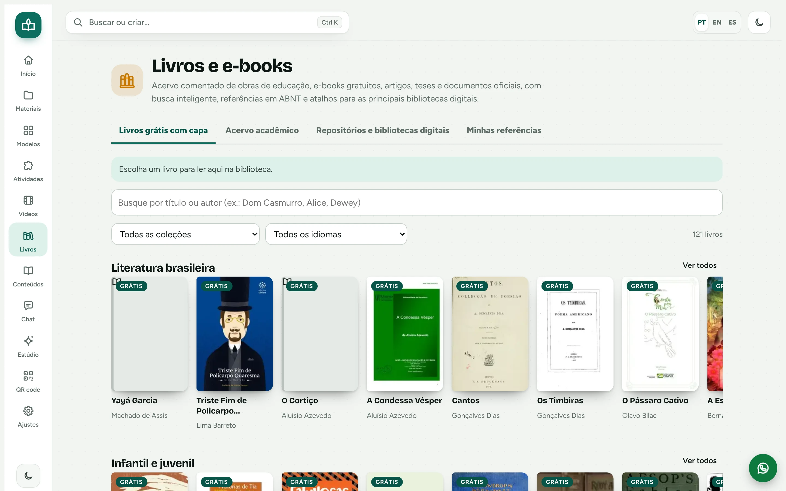 | 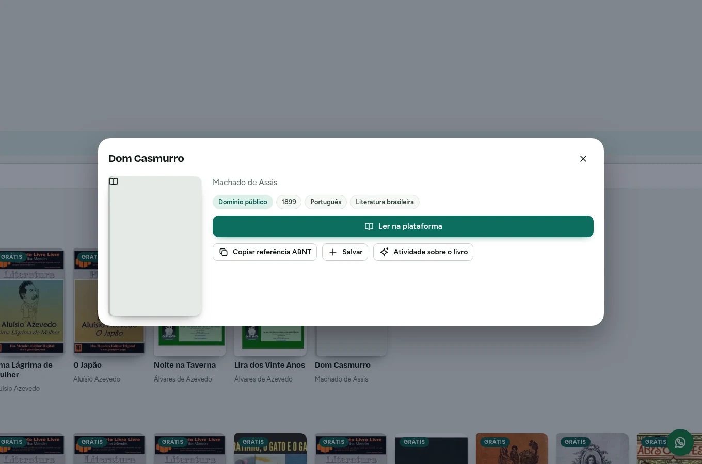 |

O leitor permite grifar trechos, marcar páginas, retomar a leitura e ajustar a fonte e o papel. Na versão hospedada, 30 obras também oferecem a página digitalizada para consultar a impressão e os diagramas. O arquivo HTML offline inclui as transcrições dos 121 livros. No modo visitante, as marcações duram a sessão. Com uma conta local, ficam no cofre cifrado do aparelho.

| Leitor com grifo | Leitor no celular |
|---|---|
| 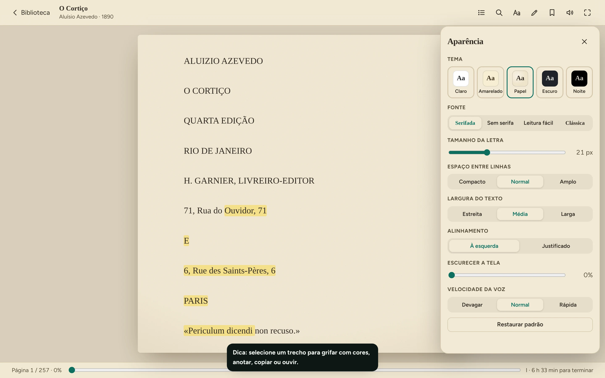 | 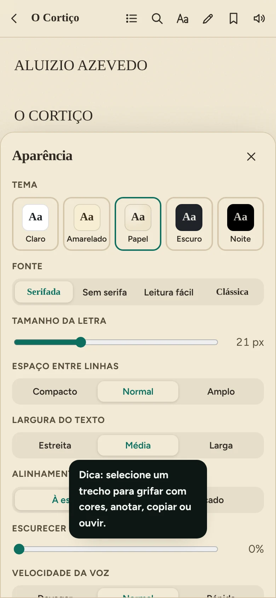 |

### Atividades prontas e 290 modelos
13 geradores de atividades comuns (caça-palavras, cruzadinha, ligar colunas, lacunas, palavras embaralhadas, ordenar frases, contas, tabuada, sílabas, ordem alfabética, conte e escreva, V/F e quiz) e 290 modelos prontos (atividades, apostilas, provas, listas, planos de aula e roteiros) de várias disciplinas e anos.


| Atividades | Modelos |
|---|---|
| 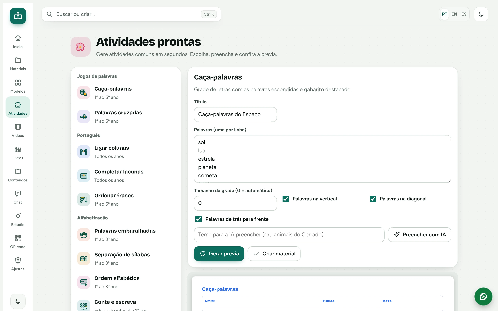 | 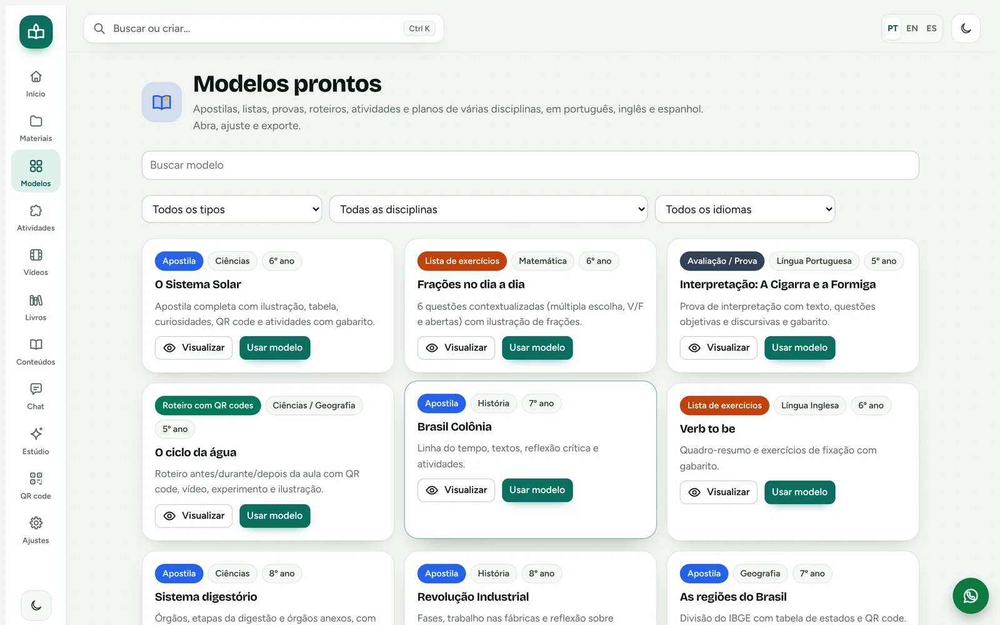 |

### Estúdio de fontes
Envie textos e arquivos e gere resumo, guia de estudo, perguntas frequentes, linha do tempo, glossário, mapa mental, quiz, flashcards, resumo em áudio, plano de aula, sequência didática e projeto educacional.

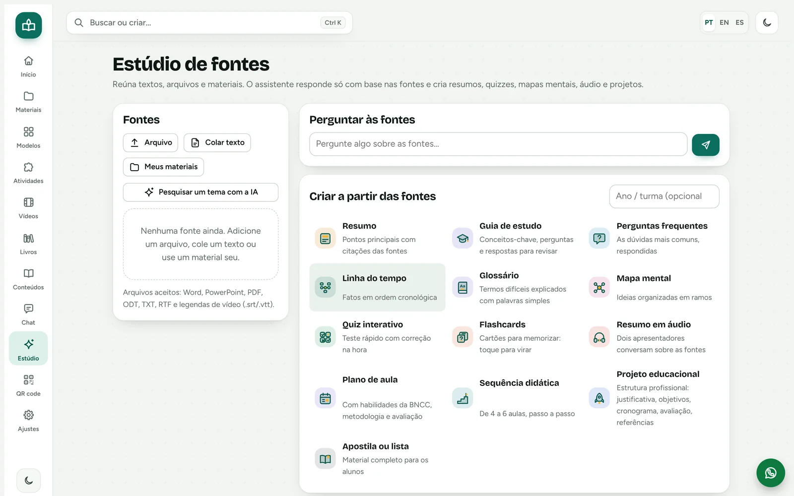

### E mais
- **Chat livre** para montar um projeto do zero e transformar a conversa em material.
- **Biblioteca de conteúdos** com temas por etapa e componente curricular e o calendário de datas comemorativas.
- **Importar** Word, PowerPoint, PDF, ODT, TXT, RTF e legendas de vídeo.
- **QR code e links**: QR com cores, logo da escola e Wi-Fi; links de WhatsApp, e-mail, YouTube no minuto certo, Google Drive, cópia do Docs e Maps.
- **WhatsApp**: envie o material como texto, com ou sem gabarito.
- **Busca rápida** (Ctrl K) para chegar a qualquer tela, ação ou material.

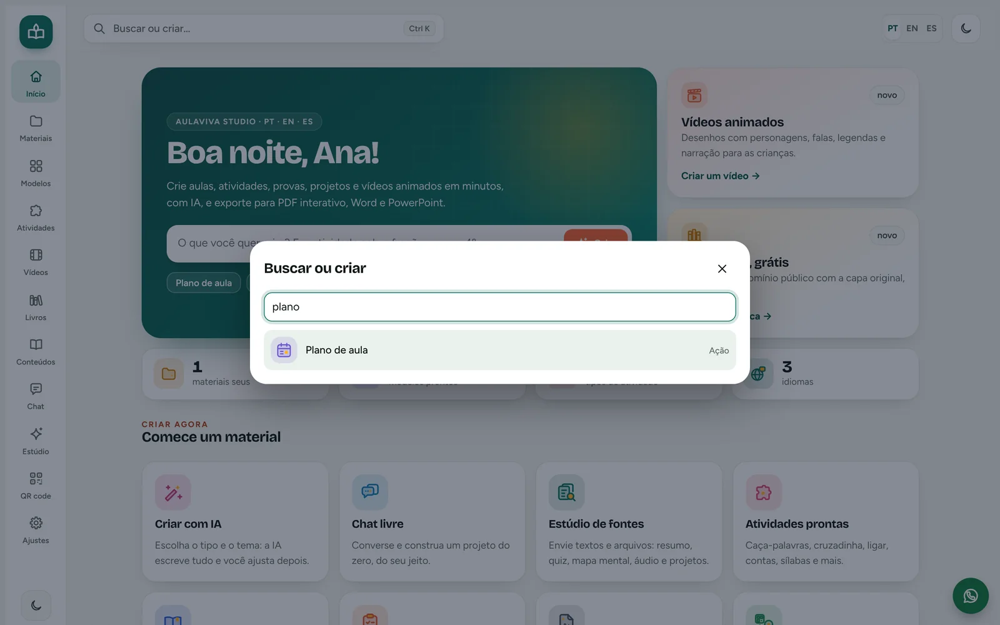

## Tema escuro, outros idiomas e celular

| Tema escuro | Em inglês |
|---|---|
| 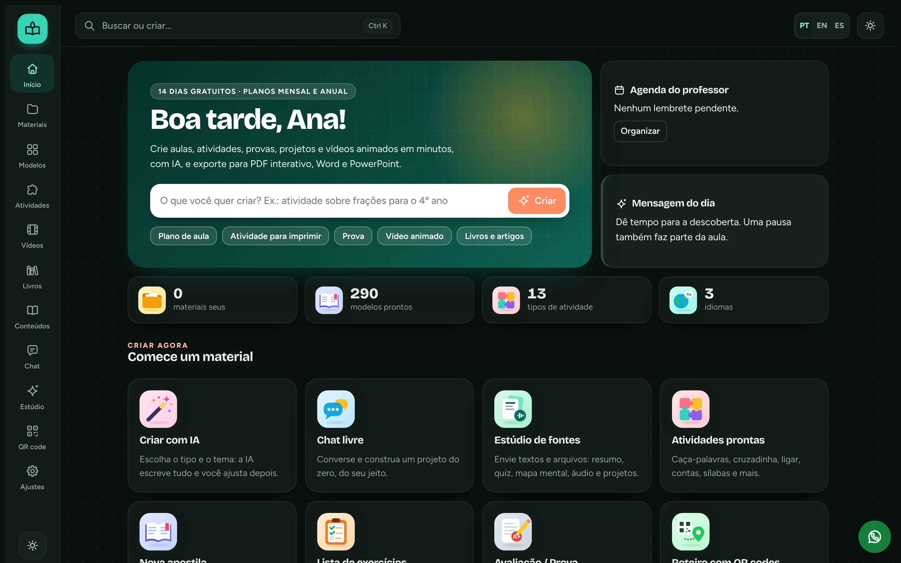 | 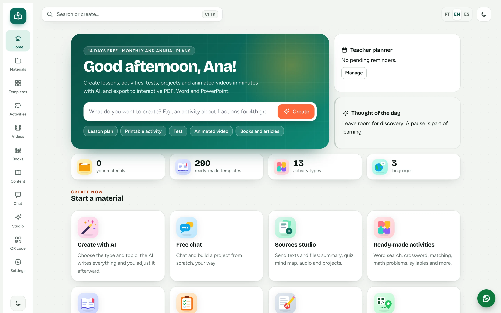 |

<p align="center">
  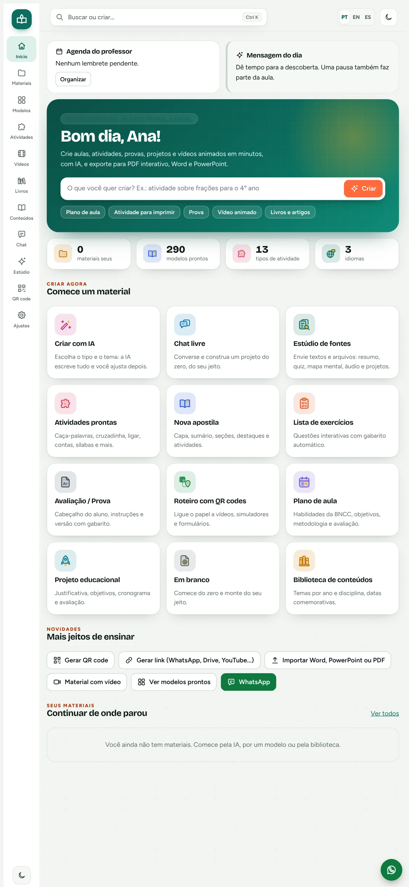
  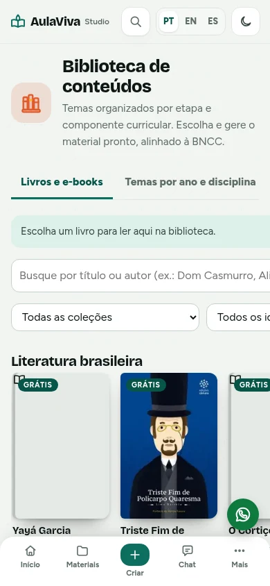
  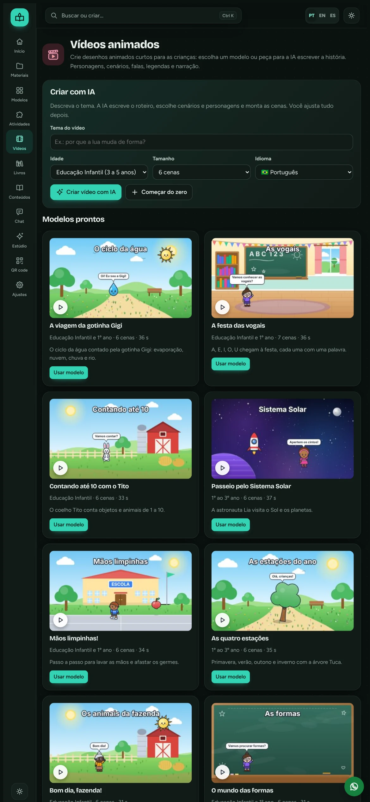
</p>

## Inteligência artificial

Em **Ajustes → Inteligência artificial**, escolha uma IA e cole a **sua** chave. Ela fica guardada só no seu navegador.

| IA | Custo |
|---|---|
| Google Gemini, Groq, Cerebras, OpenRouter, Mistral, Hugging Face | planos gratuitos |
| Ollama | grátis, roda no seu computador |
| Claude API, ChatGPT, DeepSeek, APIs compatíveis com a OpenAI | pagas, com a sua chave |

Nenhuma chave vem embutida no app. Dados pessoais de alunos nunca são enviados às IAs.

## Segurança e privacidade

O site abre com uma tela de boas-vindas e login. A conta é **local**: nada vai para servidores.

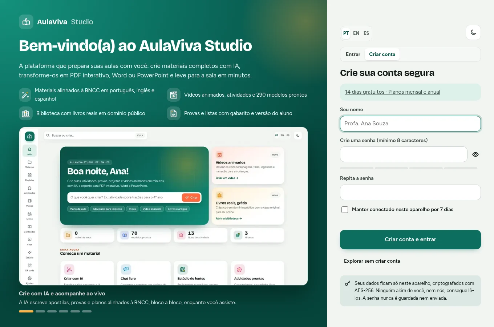

- **Criptografia de verdade:** materiais, conversas, fontes, chaves de IA e perfil ficam cifrados no navegador com **AES-256-GCM**. A chave é protegida pela senha com **PBKDF2-SHA-256 (600 mil iterações)**; a senha nunca é guardada nem enviada.
- **Código de recuperação** para redefinir a senha sem perder os materiais.
- **Bloqueio progressivo** após 5 senhas erradas e **bloqueio automático** por inatividade (5 a 60 min).
- **"Manter conectado"** opcional, com chave não exportável guardada no próprio aparelho por 7 dias.
- **Modo visitante** para explorar sem conta, sem gravar nada.
- **Cabeçalhos de segurança:** Content-Security-Policy, proteção contra abertura em iframe (clickjacking), `no-referrer`, HSTS, `nosniff` e Permissions-Policy (no Vercel, via `vercel.json`).

## Privacidade e acessibilidade

- Sem anúncios e sem rastreadores.
- Arquivos importados são lidos no seu aparelho; macros são bloqueadas.
- Interface auditada com axe (WCAG 2.1 AA) nos temas claro e escuro, navegável por teclado.

## Desenvolvimento

Use Node.js 22.3 ou mais recente para o build e os testes.

```bash
npm ci            # instala as dependências de build e testes
npm run build     # gera dist/aulaviva-studio-standalone.html (o site completo, em um arquivo)
npm test          # testes de importação, exportação e atividades
npm run test:e2e  # testes no navegador (Playwright + Chromium)
npm run test:a11y # auditoria de acessibilidade
node tests/auth.cjs   # login, criptografia, bloqueio e recuperação
node tests/screenshots.cjs   # atualiza as imagens deste README
```

O app é uma página única, sem framework: os módulos em `src/` se registram em `window.AV` e são unidos pelo `build.mjs`. As bibliotecas pesadas (jsPDF, docx, PptxGenJS, JSZip, mammoth, pdf.js) carregam sob demanda. O site pronto fica em `dist/site/index.html` e é publicado no GitHub Pages (`.github/workflows/pages.yml`) e na Vercel (`vercel.json`) a cada atualização do `main`.

```
src/        núcleo, idiomas, editor, telas, IA, exportação, importação, atividades, animação, estilos, ícones
data/       modelos, acervo, repositórios digitais e livros (com capas)
spec/       contratos dos módulos
tests/      testes de unidade, de navegador e geração de imagens
docs/       imagens do README
```

## Créditos

A biblioteca hospeda transcrições de edições do [Internet Archive](https://archive.org), do [Project Gutenberg](https://www.gutenberg.org) e do [Standard Ebooks](https://standardebooks.org). Digitalizações convertidas por OCR podem conter erros e perder ilustrações. Os textos estão em `data/textos/`, e os créditos e as informações de edição complementares ficam em `data/edicoes.json`. Fontes: [Bricolage Grotesque](https://fonts.google.com/specimen/Bricolage+Grotesque) e [Figtree](https://fonts.google.com/specimen/Figtree), pelo Google Fonts.
